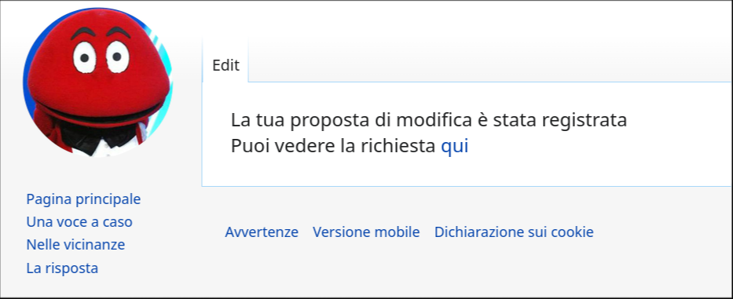
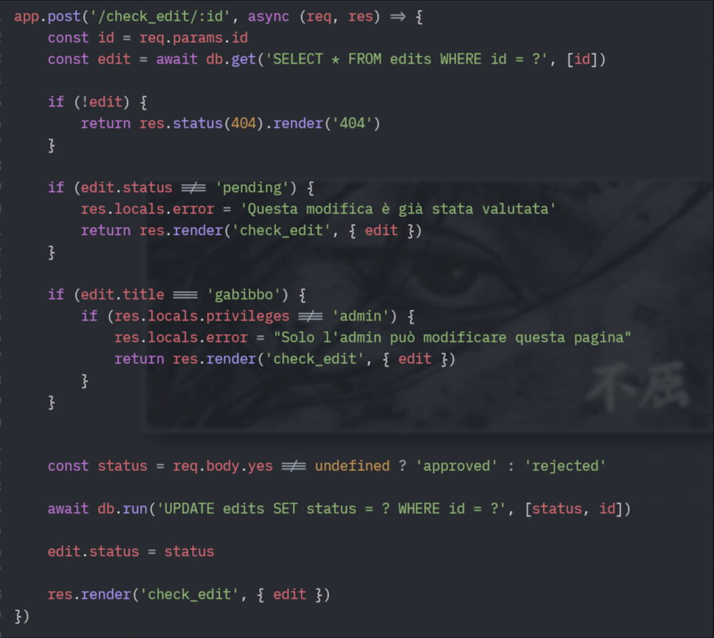

# Bibbopedia 1 e 2

**CTF:** OliCyber.IT Competizione Nazionale 2025  
**Categoria:** Web

## 📝 Contesto

Il sito rappresenta una scherzosa copia di wikipedia dove è possibile suggerire delle modifiche alle pagine.  Per la pagina `/wiki/gabibbo` è necessaria l'approvazione dell'admin, mentre per le altre di un editor

## 🔍 Soluzione

### 🚩 Prima flag - IDOR

Per ottenere la prima flag è necessario riuscire a modificare una pagina, quindi a suggerire una modifica e a far sì che questa sia approvata.
Affinchè ciò accada prendiamo come esempio la pagina `/wiki/42` e osserviamo nel codice come avviene la richiesta di modifica e l'approvazione dagli editor.

Notiamo che una volta effettuata una richiesta di modifica con una POST a `/edit/:title` riceviamo questa pagina



con href che porta alla pagina `/check_edit/:id_edit`

Notiamo poi che per ricevere l'approvazione una volta richiesto l'edit, basta lanciare una richiesta POST alla medesima pagina , con un parametro `yes` con qualsiasi valore



Notiamo infatti come la query assegnerà approved se il parametro yes sarà diverso da undefined.

Ci basterà quindi mandare questa richiesta per ottenere la prima flag.

### 🚩 Seconda flag - XSS

Per ottenere la seconda sarà necessario modificare la pagina `/wiki/gabibbo` , con la differenza che prima di assegnare la modifica con lo stesso meccanismo delle altre pagine, sarà effettuato un check sul ruolo dell'utente che esegue la richiesta. Dobbiamo far sì che quindi la richiesta venga effettuata da un admin, dato che non c'è modo di fare privilege escalation.

Notiamo che ogni volta che suggeriamo una modifica, la pagina viene visitata da un bot che ha privilegi admin. Dovremo quindi richiedere una modifica sulla pagina `/wiki/gabibbo` , prendere l'id della richiesta e con un semplice XSS far si che il bot la approvi.

Viene effettuato un banale check sul tag `<script>` quindi utilizziamo un payload alternativo come questo per aggirare il controllo, e lo suggeriamo come modifica in una qualsiasi pagina: 

```html
<svg onload="fetch('http://bibbopedia.challs.olicyber.it/check_edit/:id_richiesta', {
  method:'POST',
  headers: {'Content-Type' : 'application/x-www-form-urlencoded'},
  body: new URLSearchParams({yes : 'pierreics'})
})"></svg>
```

In questo modo appena suggeriamo una modifica a una qualsiasi pagina, il bot effettua una richiesta POST con parametro yes in modo tale che la richiesta venga approvata.

Torniamo quindi sul link della richiesta per verificarne l'approvazione e raccogliere la flag 

